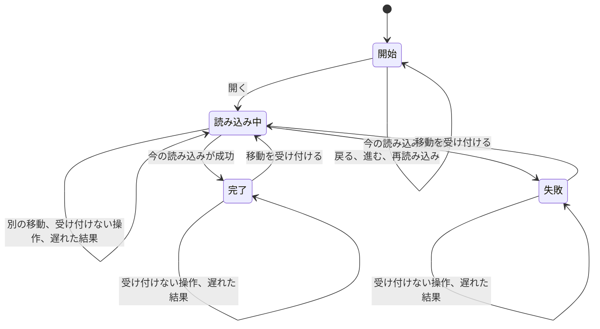
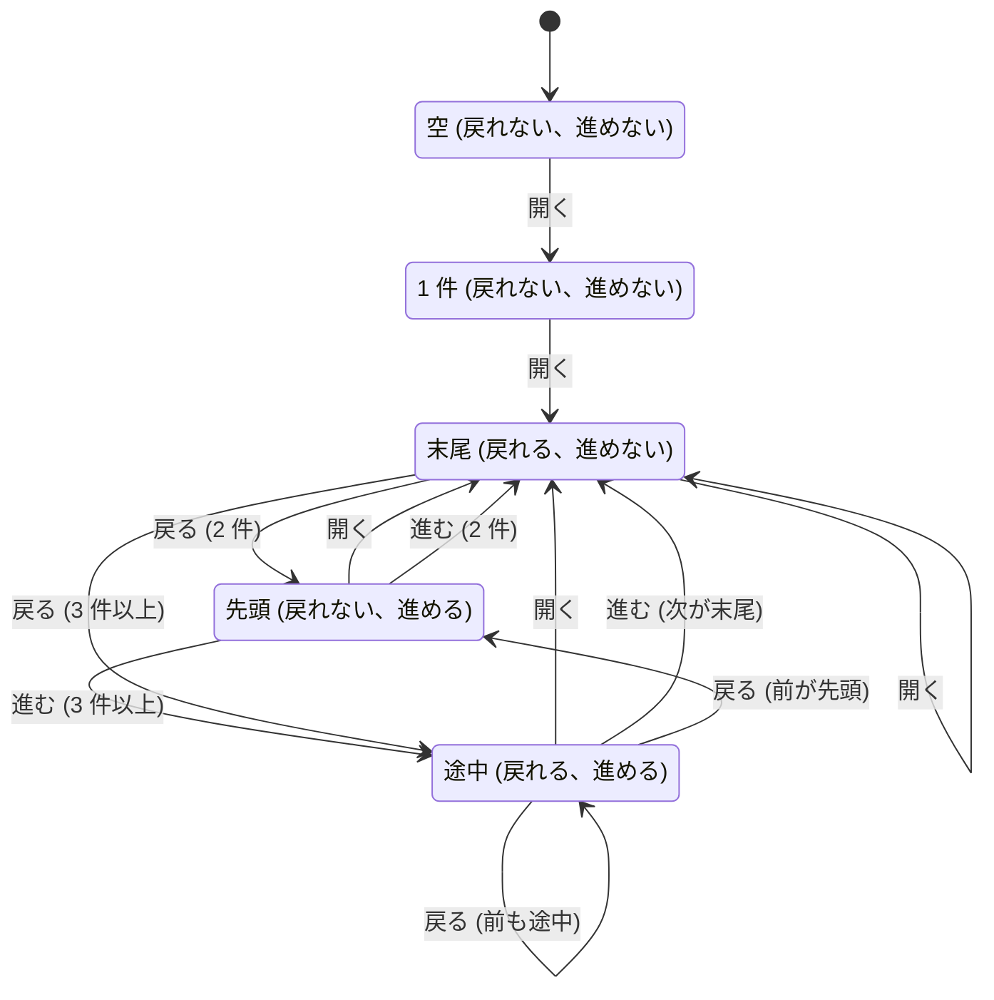

# ナビゲーションの状態遷移

1 つのウィンドウで、開いているページは 1 つです。タブと、複数のウィンドウは、この図にありません。

この図よりあとのナビゲーションは、この図に合わせます。 S11 の戻る、進む、再読み込みも、ここに書いた通りに動きます。アドレスバーから開くのも、ページのリンクを開くのも、図の「開く」です。

## 人が見ているもの

- 様子は、開始、読み込み中、完了、失敗のどれかです。
- 履歴は、受け付けた URL の列と、現在の位置です。
- 表示は、様子と、見えている中身です。見えている中身は、空か、ある URL のページか、ある URL の失敗です。

戻れるのは、現在より前に項目があるときだけです。進めるのは、現在より先に項目があるときだけです。

開始は、まだ 1 件も開いていないときです。起動して最初の URL を開くと、開始から読み込み中へ移ります。引数がないときのフィクスチャも、この最初の「開く」です。

## 移動の規則

次の操作を受け付けます。受け付けない操作は、履歴も表示も変えません。読み込み中なら、その読み込みは続きます。

- 開くは、いつでも受け付けます。
- 戻るは、戻れるときだけ受け付けます。
- 進むは、進めるときだけ受け付けます。
- 再読み込みは、開いているページがあるときだけ受け付けます。開始のときは受け付けません。

受け付けた移動は、すぐに履歴を変え、様子を読み込み中にします。見えている中身は、その読み込みが成功するか失敗するまで、直前のままです。読み込みの途中では、見えているページが履歴に無いことがあります。結果が届くと、見えている中身は現在の URL に揃います。

- 開くと、現在より先の項目を消し、開いた URL を末尾に足して、そこを現在にします。同じ URL でも新しい 1 件として足します。
- 戻ると、列はそのままで、現在が 1 つ前に移ります。今いた URL は進む側に残るので、そこへ進めます。 2 件目を開いたあとで戻っても、履歴は 1 件にはなりません。
- 進むと、列はそのままで、現在が 1 つ次に移ります。
- 再読み込みは、列も位置も変えません。進む側も残ります。

戻れるときに戻して、前のページが見えるのは、その読み込みが成功したときです。押した直後に変わるのは、現在の URL と様子です。

読み込み中に別の移動を受け付けると、進行中の読み込みを捨てます。捨てた読み込みには印を付け、その成功や失敗があとから届いても、履歴も表示も変えません。捨てた結果は、今の読み込みが完了したあとや、失敗したあとにも届くことがあります。そのときも、履歴も表示も変えず、印だけが消えます。様子は、完了か失敗のままです。今の読み込みの結果だけを使います。読み込み中でない移動は、すでに残っている印を消しません。成功と失敗も、その印を消しません。

今の読み込みが成功すると、様子は完了になり、見えている中身は現在の URL のページになります。失敗すると、様子は失敗になり、見えている中身は現在の URL の失敗になります。どちらも、履歴の位置は受け付けたときのままです。失敗した URL も履歴に残るので、戻る、進む、再読み込みができます。再読み込みは、その URL をもう一度読みます。

実装は、読み込みに番号を付け、今の番号の結果だけを成功か失敗として使います。違う番号の結果は、遅れた結果として捨てます。

## 様子

受け付ける移動は、開く、戻れるときの戻る、進めるときの進む、ページがあるときの再読み込みです。別の移動は、読み込み中にこれらを受け付けることです。様子は読み込み中のままですが、履歴は次の図と、下の性質に従って変わります。

## 戻れるか、進めるか

成功、失敗、遅れた結果、再読み込み、受け付けない操作は、この図の場所を変えません。

1 件へ戻る矢印はありません。 2 件以上になってから戻ると、進む側が残るので、先頭か途中か末尾です。

## 性質

検査は、図と同じ状態のすべての到達について、次が成り立つことを見ます。番号は説明用です。検査の出力に出る名前は、各項目の文です。

1. 戻れないときに戻しても、履歴も表示も遅れの印も変わらない
2. 進めないときに進んでも、履歴も表示も遅れの印も変わらない
3. ページがないときに再読み込みしても、履歴も表示も遅れの印も変わらない
4. 新しい移動を受け付けると、進む履歴は消え、現在はその URL になり、様子は読み込み中になる
5. 戻れるときに戻すと、履歴の並びは残って、現在は 1 つ前になり、様子は読み込み中になる
6. 進めるときに進むと、履歴の並びは残って、現在は 1 つ次になり、様子は読み込み中になる
7. 再読み込みでは、履歴の並びと位置は変わらず、様子は読み込み中になる
8. 読み込み中の移動は、その読み込みを遅れにする。読み込み中でなければ、残っている遅れを消さない
9. 遅れて届いた結果は、履歴も表示も変えず、遅れの印だけを消す
10. 見えている中身が変わるのは、今の読み込みが成功したときか、失敗したときだけである
11. 成功すると、完了になり、履歴の位置は変わらず、見えている中身は現在の URL のページになる
12. 失敗すると、失敗になり、履歴の位置は変わらず、見えている中身は現在の URL の失敗になる
13. 成功と失敗は、残っている遅れを消さない
14. 戻れるのは前に項目があるときだけ、進めるのは先に項目があるときだけである
15. 開始なのは履歴が空のときだけで、そのとき見えている中身は空である
16. 位置は履歴の列の中にあり、検査では列は 4 件までである

上の性質が空振りしていないことは、次の到達で見ます。

- 届く: 開く
- 届く: 戻れないときの戻る
- 届く: 戻れるときの戻る
- 届く: 進めないときの進む
- 届く: 進めるときの進む
- 届く: ページがないときの再読み込み
- 届く: ページがあるときの再読み込み
- 届く: 成功
- 届く: 失敗
- 届く: 遅れた結果
- 届く: 完了か失敗のあとの遅れた結果
- 届く: 戻れて進める完了
- 届く: 読み込み中の別の移動

## 例

a 、 b 、 c は、別々の URL です。

1. 開始です。履歴は空、表示は空、戻れず、進めません。
2. a を開きます。読み込み中、履歴は `[a]` 、表示は空のまま、戻れず、進めません。
3. 成功します。完了、見えている中身は a のページです。
4. 再読み込みします。読み込み中、履歴は `[a]` のまま、見えている中身は a のページのままです。
5. 成功します。完了のまま、見えている中身は a のページです。
6. b を開きます。読み込み中、履歴は `[a, b]` 、現在は b 、見えている中身は a のページのままです。戻れて、進めません。
7. ここで進んでも、何も変わりません。 b の読み込みは続きます。
8. 戻します。読み込み中、履歴は `[a, b]` のまま、現在は a です。見えている中身は a のページのままです。戻れず、進めます。 b の読み込みは遅れになります。
9. 遅れて b の成功が届いても、履歴も表示も変わりません。
10. a の読み込みが成功します。完了、見えている中身は a のページ、戻れず、 b へ進めます。
11. c を開きます。読み込み中、履歴は `[a, c]` です。 b は消えます。現在は c 、見えている中身は a のページのまま、戻れて、進めません。
12. 失敗します。失敗、履歴は `[a, c]` のまま、見えている中身は c の失敗です。

手順 3 の、履歴が `[a]` だけのときに戻しても、何も変わりません。履歴が `[a, b]` で現在が a のときに a を開くと、履歴は `[a, a]` になり、進む側にあった b は消えます。

## 検査の範囲

モデルが持つ、人が見る状態は、この図の様子、履歴、表示です。戻れるかと進めるかは、履歴から決まります。検査は、その状態に加えて、直前の操作と、遅れの印を覚えます。印は、捨てた読み込みの結果を 1 件だけ届けるためのもので、人が見る状態ではありません。それより古い結果は、届かないものとして検査します。

URL は 3 種類、履歴は 4 件までです。ブラウザの実装には、この上限を付けません。 4 件あって現在が末尾のときは、開くを検査しません。末尾で開いて進む側が消えることは、 3 件以下で検査します。途中から途中への戻ると進むは、 4 件までで検査します。

検査のコマンドは `cargo run -q -p nav-model` です。出力は [check.txt](check.txt) です。道具は [状態を持つ部分の検査には stateright を使う](../../adr/0006-stateright.md) です。
